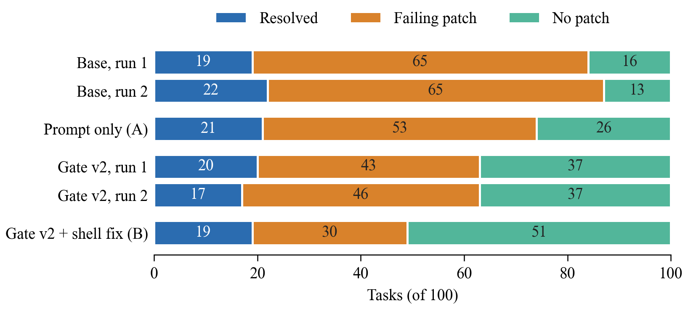

# MetSWE: an offline benchmark for coding agents on weather software

MetSWE is a set of **147 repair tasks** from eight Python libraries used in atmospheric science (MetPy, Py-ART, pysteps, wradlib, Satpy, pyresample, geocat-comp, xarray). Every task was validated in the official air-gapped grader of the Gemma 4 Developer Agent competition: the empty patch fails and the gold patch passes twice in a row, with networking disabled.

Paper: [MetSWE: An Offline Benchmark for Gemma 4 Coding Agents on Weather Software](https://www.kaggle.com/competitions/gemma-4-developer-agent-paper/writeups/metswe-an-offline-benchmark-for-gemma-4-coding-ag) (Kaggle writeup, paper track).

## At a glance

- **Benchmark.** 147 tasks with issue text, gold and test patches, sources, labels and splits; offline image recipes with test data pre-installed; a script that checks any task with networking off.
- **Agent results.** Every run of a local Gemma 4 31B agent (base, mechanical pre-submission checks "gate v2", two ablations, a knowledge pack), with full trajectories.
- **Main finding.** Gate v2 lowers failing patches from 130 to 89 of 200 task-runs (p < 0.001), also on held-out tasks; every run resolves 17-22 of 100 tasks.
- **Reproducible.** CPU scripts recompute every number and figure in the paper from `results/` and `benchmark/`.



**Recompute the main numbers (Python 3 standard library only, no Docker, under a minute):**

```bash
git clone https://github.com/Yuxiang-Ren-HUB/metswe-offline-agent.git
cd metswe-offline-agent
python3 -X utf8 analysis/replication.py   # base vs gate v2 over both runs: failing patches 130 -> 89, sign tests
python3 -X utf8 analysis/ablation.py      # ablations A and B: Table 2 (printed after a trace summary)
python3 -X utf8 benchmark/funnel.py       # selection funnel: 279 executed -> 154 -> 147 valid
```

`-X utf8` makes Python read the data files as UTF-8 on Windows; on Linux and macOS it changes nothing.

**Names used in the scripts and folders** (`results/31b_<name>/`): `base` and `base_r2` (base, runs 1 and 2), `gate2` and `gate2_r2` (gate v2, runs 1 and 2), `gateprompt` (ablation A), `gate2sh` (ablation B), `kp` (knowledge pack), `gate` and `kp_gate` (gate v1, development tasks only). Coverage is submitted patches per task; precision is resolved tasks per submitted patch; a task-run is one task in one run.

This page has five parts:
1. a quick check that a task behaves as validated;
2. the task list and splits;
3. recomputing the paper's tables and figures (CPU only, no Docker);
4. building the environments and running offline;
5. known limitations.

Section 3 needs nothing but Python. Sections 1 and 4 need Docker and the competition's harness.

## 1. Quick check: the empty patch fails, the gold patch passes

Prerequisites, prepared once **with** network access (Section 4 has the details):
- WSL2 or Linux with Docker;
- the competition's data download from Kaggle, which contains the `swegemma` wheelhouse (the harness is not redistributed here);
- Python 3.12 with the competition's `swegemma` 0.2.7 harness installed from its wheelhouse;
- the Py-ART image `met-sandbox-pyart:warm` (`bash env/build_image.sh pyart`);
- the two task snapshots (`python3 benchmark/validate_tasks.py snapshot --ids pyart__1894,pyart__1895`).

Then, **without** network access:

```bash
python3 benchmark/verify_demo.py --ids pyart__1894,pyart__1895 --out /tmp/metswe_demo.jsonl
```

Expected output: for each task, `empty patch resolved=False`, `gold patch resolved=True`, then `2 / 2 tasks behave as validated`. The grader starts its containers with `network_mode=none`. The script makes no network calls, and talks to Docker over its local socket. To check that it does not depend on the host network, you can run it inside a network namespace without network: `sudo unshare -n -- "$(command -v python3)" benchmark/verify_demo.py ...` (the full path of the Python that has `swegemma` installed). Any task id from `benchmark/tasks_final.jsonl` works, once its repository image and snapshot exist.

## 2. Tasks and splits

| File | Contents |
|---|---|
| `benchmark/tasks_final.jsonl` | The 147 tasks: issue text, base commit, gold patch, test patch, merge date, source PR and issue, overlap with other benchmarks |
| `benchmark/tasks_exp100.jsonl` | MetSWE-100, the experiment subset: all 71 non-xarray tasks and 29 xarray tasks drawn with a fixed seed |
| `benchmark/validation_rounds.jsonl`, `benchmark/validation.jsonl` | Grader runs behind every kept or dropped candidate (279 executed); the final re-check on the final images |
| `benchmark/funnel.py` | Recomputes the selection funnel from the executed candidates (279 → 154 → 147) with the reason each candidate was dropped, and prints the 3,467 commits that changed tests and at most 3 source files. The 408 candidates linked to an issue are `benchmark/tasks_unvalidated.jsonl`, one per line |
| `benchmark/task_types_reviewed.jsonl` | One problem type per MetSWE-100 task and a domain-specific flag. Labels were assigned by an LLM and reviewed in a second LLM pass; no human validation |
| `benchmark/overlap_check.md` | Which other SWE-style task sets contain these repositories, and the limits of that check |

**Development and held-out tasks.** Experiments ran in rounds over the first *k* tasks of each repository in `tasks_exp100.jsonl`. The 47 tasks gate v1 ran on (the first 10 or fewer per repository) are the development set; the other 53 (34 Satpy, 19 xarray) are held out. `results/31b_gate/results.jsonl` lists the development task ids.

## 3. Recomputing the paper's numbers (CPU only)

```bash
python3 -X utf8 analysis/final_summary.py     # run 1: outcome tables, sign tests, per-repository counts
python3 -X utf8 analysis/replication.py       # both runs: pooled comparison (130 -> 89), rerun agreement, losses; Figure 3 data
python3 -X utf8 analysis/cpu_extra.py         # random-thinning baseline, bootstrap intervals, post-hoc filter
python3 -X utf8 analysis/gate_evidence.py     # what the gates rejected and repaired
python3 -X utf8 analysis/call_budget.py       # where gate v2's tool calls go, from the agent traces
python3 -X utf8 analysis/verify_claims.py     # spot checks of individual claims
python3 -X utf8 analysis/hard_evidence.py     # what each G4 rejection rested on
python3 -X utf8 analysis/domain_sensitivity.py  # domain-specific vs generic tasks (exploratory)
python3 -X utf8 analysis/ablation.py          # ablations A and B: Table 2 and the mechanism metrics
python3 -X utf8 analysis/ablation_thinning.py # random-thinning check for every condition; Figure 2 data
python3 -X utf8 analysis/abl_extra.py         # why tasks end with no patch (exploratory)
```

The analysis scripts need only the standard library and read only `results/` and `benchmark/`; two of them also write the figure data described below:
- `results/31b_<name>/results.jsonl` has one line per task: resolved, patch, tool calls, error, time;
- `results/31b_<name>/offline_events.jsonl` logs the gate and knowledge-pack calls;
- `results/31b_<name>/harness/traces/` holds the full agent trajectories, one file per task.

G1-G5 are the five gate checks (source file changed; no test or config edits; files parse and modules import; reproduction script fails before and passes after the patch; related tests gain no failures), implemented in `agent/skills/presubmit-check/`.

**Figures** (need matplotlib and numpy, for example `python3 -m pip install matplotlib numpy`):

```bash
python3 -X utf8 figures/plot_figs_atm.py      # redraws Figures 1-3 into figures/atm/, overwriting the committed PNGs
```

The plotting script reads `figures/fig_ablation_data.json` (Figure 2) and `figures/fig2_data.json` (Figure 3). `analysis/ablation_thinning.py` and `analysis/replication.py` rewrite these two files from `results/` each time they run, so running the analysis scripts first redraws the figures from the raw results. The committed copies let the figures be drawn without running them. File names follow the drafts: `fig_gate_flow.png` is Figure 1, `fig_ablation.png` Figure 2 and `fig2_rerun.png` Figure 3; `plot_gate_flow_variants.py` holds the drawing code for Figure 1. The other files in `figures/` (`fig1_outcomes.png`, `plot_fig1_outcomes.py`, `plot_fig2_rerun.py`, `compute_fig_data.py`, `fig_data.json`) belong to an earlier draft.

`analysis/ablation_analysis_plan.md` is the analysis plan for the ablations, frozen before any ablation result was inspected, with the execution record and the analyses added afterwards. Held-out ablation rows disrupted by another GPU job and discarded under its timing rule are kept unchanged in `results/_discarded_20261108/`.

**Main results on MetSWE-100** (one row per run; 100 tasks each):

| Run | Resolved | Failing patch | No patch | Coverage | Precision |
|---|---|---|---|---|---|
| base, run 1 | 19 | 65 | 16 | 0.84 | 0.23 |
| base, run 2 | 22 | 65 | 13 | 0.87 | 0.25 |
| gate v2, run 1 | 20 | 43 | 37 | 0.63 | 0.32 |
| gate v2, run 2 | 17 | 46 | 37 | 0.63 | 0.27 |
| ablation A (prompt only) | 21 | 53 | 26 | 0.74 | 0.28 |
| ablation B (shell fix) | 19 | 30 | 51 | 0.49 | 0.39 |
| knowledge pack | 18 | 68 | 14 | 0.86 | 0.21 |

Gate v1 and knowledge pack + gate v1 ran only on the 47 development tasks (`results/31b_gate`, `results/31b_kp_gate`).

## 4. Building the environments and running offline

**Paths to edit.** The scripts were written for one machine:
- `/opt/offline` for snapshots, logs and outputs (override with `OFFLINE_WORK`);
- `/mnt/f/kaggle/gemma_agent/...` for this tree and the competition data;
- a local proxy at `127.0.0.1:7897` in the older build scripts.

Edit these at the top of each script before running.

**Preparation, with network access:**
1. `bash env/setup_wsl.sh`: Docker, the competition harness from its wheelhouse, and the competition's base image `swebench-sandbox:latest` (both come with the competition's data download). It also creates a vLLM environment for the competition's official model; the paper's runs used Ollama instead (see Offline below).
2. `bash env/build_image.sh <repo>` for each repository you need (`metpy`, `geocat-comp`, `pyart`, `pyresample`, `satpy`, `wradlib`, `pysteps`, `xarray`).
   - The script reproduces the layer order of the images used in the paper, as read from their `docker history`.
   - It ends with a warm-up that runs every task's tests once, so that data caches are baked into the `:warm` image.
   - Package versions are resolved at build time. `bash env/build_image.sh --check <repo>` compares the result with `env/locks/<repo>.txt`, the `pip freeze` of the paper's images. `env/locks/image_ids.txt` gives those images' ids.
3. `python3 benchmark/validate_tasks.py snapshot --ids <ids>`: repository snapshots at each task's base commit, with 30 commits of history.

**Offline:**
- `benchmark/verify_demo.py` checks any task (Section 1).
- `benchmark/validate_tasks.py verify` repeats the full validation.
- Re-running the agent needs Ollama serving the Gemma 4 31B QAT Q4_0 GGUF at 32K context. The experiment queues `agent/run_all.sh`, `run2.sh`, `run3.sh` and `run4.sh` are kept exactly as run.
- Sampling uses temperature 0.2, so a re-run reproduces the distribution of outcomes, not the same trajectories.

## 5. Known limitations

- **Harness.** The harness is the competition's `swegemma` 0.2.7, which is not redistributed here. The competition later moved to 0.2.11; our gold-patch validation and all runs used 0.2.7.
- **Grading.** The grader requires every test in the touched test files to pass. Some candidates were dropped because their gold patch failed its own tests offline, which biases the set towards tasks with self-contained tests.
- **Repositories.** Most meteorology-specific repositories contribute only 2–9 tasks, and the held-out split covers only Satpy and xarray.
- **Overlap check.** It covers eight task sets as served on 2026-10-12; dataset revisions were not recorded (see `benchmark/overlap_check.md`).
- **Task labels.** Labels in `task_types_reviewed.jsonl` were assigned by an LLM and reviewed by an LLM, without human validation.
- **Rebuilt images.** A rebuilt image can differ in package versions from the paper's; check with `build_image.sh --check`.

## License

Apache 2.0, see `LICENSE`. Task data quote issue text and patches from the upstream repositories, which remain under their own licenses.
